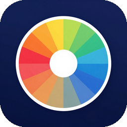

# 调色台

纯 `tkinter` 实现的取色 / 调色小工具，**零第三方依赖**。



## 功能

- 左侧**色相-饱和度色轮**，鼠标在轮上拖动直接取色
- 右侧七条渐变滑条：色相 / 饱和度 / 明度 / 红 / 绿 / 蓝 / 不透明度
- 每条滑条右边有数字框，可以直接敲精确值
- 实时输出 **HEX / RGB / RGBA** 三种编码，一键复制
- 棋盘格预览不透明度叠加效果
- 预设色板，点一下套用
- 按屏幕 DPI 缩放，高分屏下不糊、不挤

## 运行

```bash
python 调色台_ai.py
```

只要装了 Python（自带 tkinter）就能跑，不需要 pip 装任何东西。

## 文件

| 文件 | 说明 |
|---|---|
| `调色台_ai.py` | 主程序 |
| `调色台图标_ai.ico` / `调色台_ai_icon.png` | 窗口 / 图标资源 |

## 说明

- 仅 Windows（用了 `ctypes` 处理 DPI 感知）
- 颜色换算全部手写，没有引入 Pillow 之类的图像库
